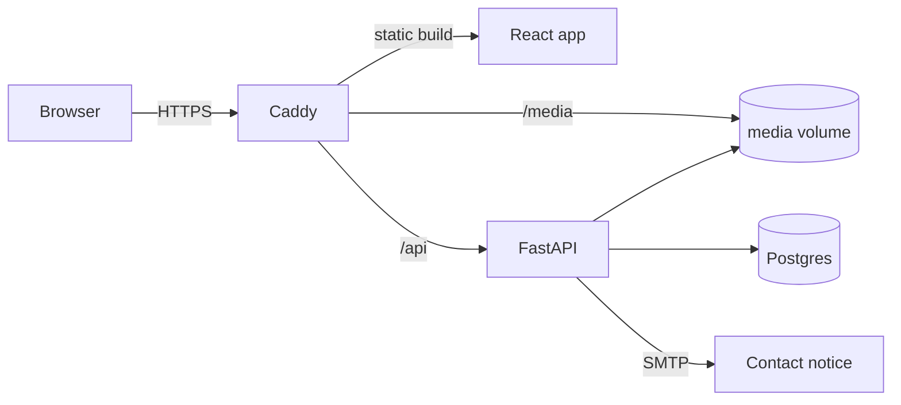

# Portafolio-Page

Bilingual (Spanish and English) portfolio site with an admin panel. The public page shows the profile, projects, experience and a contact form; the panel edits all of it, uploads project screenshots and shows contact messages and visits per campaign link.

The repository is also a sample of how I build software: a typed API with tests against a real database, a strict TypeScript frontend, security checks in CI and a deployment that rolls itself back when a health check fails.

## Stack

| Layer | Technology |
|---|---|
| API | Python 3.14, FastAPI, Pydantic 2, SQLAlchemy 2, Alembic |
| Web | React 19, TypeScript (strict), Vite, React Router, TanStack Query |
| Database | Postgres 18 |
| Serving | Caddy: HTTPS, static files, `/media` and the `/api` proxy |
| Tests | pytest, Vitest, Playwright |
| CI/CD | GitHub Actions, images in GHCR, deployment over SSH |

## Architecture



Everything runs under one domain with Docker Compose. The page loads its content with a single `GET /api/bootstrap` call, which also records the visit and picks the language. Details in [docs/architecture.md](docs/architecture.md).

## Run locally

Requirements: Docker with Compose v2.

```bash
cp .env.example .env
docker compose up -d
```

| URL | What |
|---|---|
| http://localhost:5173 | The page (`/admin` for the panel) |
| http://localhost:8000/api/health | 200 when the API and the database respond |
| http://localhost:8000/docs | Interactive API documentation |

Code changes reload on their own, and migrations run on every `up` before the API starts. To enable the admin panel and the contact email, fill in the `ADMIN_*` and `SMTP_*` variables described in `.env.example`.

## Tests and checks

```bash
# API: runs against the compose Postgres
docker compose run --rm migrate pytest -q --cov=app --cov-fail-under=80
docker compose run --rm migrate sh -c "ruff check . && ruff format --check . && mypy app"

# Web
cd web && npm ci
npm run test:coverage
npm run lint && npm run typecheck && npm run format:check
npm run e2e        # Playwright, with the compose stack up
```

What each kind of test covers is in [docs/testing.md](docs/testing.md).

## CI/CD

| Workflow | Runs on | What it does |
|---|---|---|
| `ci.yml` | Every PR and push to `dev` and `main` | Lint, types, unit tests with 80 % coverage, E2E, and `deploy-check`: the production stack started from scratch, a deploy, a forced rollback and an encrypted backup restored |
| `security.yml` | Every PR, push and weekly | CodeQL, `pip-audit`, `npm audit` and Trivy on the production images |
| `deploy.yml` | Push to `main`, then a manual run | Publishes the images to GHCR; a manual run deploys a given commit and rolls back on a failed health check |
| `ai-review.yml` | PRs to `dev` | An automated code review that comments and never approves |

Deployment and backups are described in [deploy/README.md](deploy/README.md).

## Documentation

| Document | Content |
|---|---|
| [docs/architecture.md](docs/architecture.md) | Components, request flow, data model and security |
| [docs/api.md](docs/api.md) | Routes, validation and protections |
| [docs/testing.md](docs/testing.md) | What is tested, at which level and why |
| [docs/development.md](docs/development.md) | Code conventions, branches, review, CI and repository rules |
| [docs/adr/](docs/adr/) | Architecture decision records |
| [deploy/README.md](deploy/README.md) | Production stack, deployment, backups and restore |
| [CHANGELOG.md](CHANGELOG.md) | Changes per release |

## Repository layout

```
api/            FastAPI app, tests and Alembic migrations
web/            React app, unit tests and Playwright tests
deploy/         Production compose file, Caddyfile, deploy and backup scripts
db/init/        Creates the API's database user on first start
docs/           Architecture, API, testing, development rules and ADRs
.github/        Workflows, rulesets, Dependabot and the PR template
compose.yml     Local development stack
AGENTS.md       Guidance for coding agents
```
