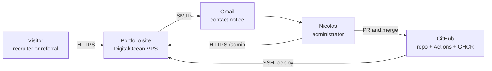
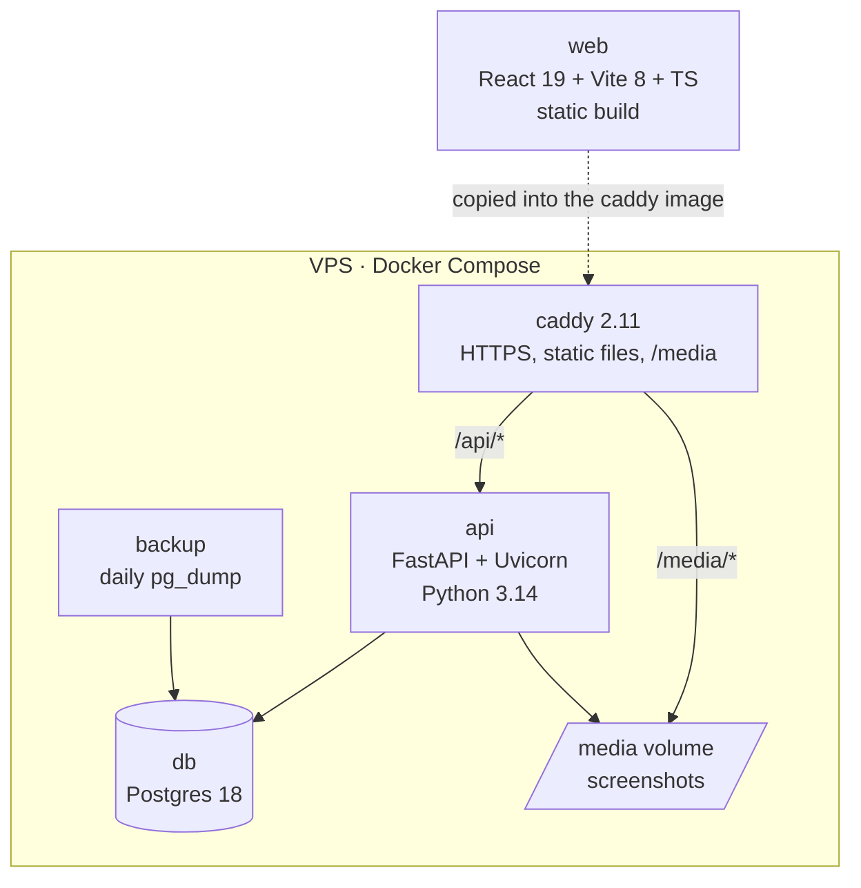
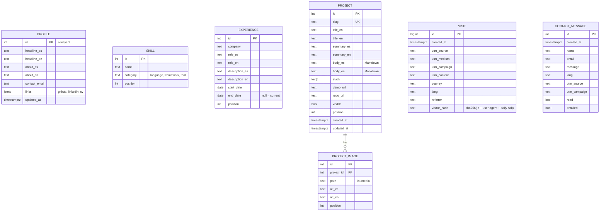

# Architecture · Portfolio website

Versions checked on 2026-10-11 on PyPI, npm and Docker Hub. Prices taken from the official pages that same day, in USD (US dollars) and at about 950 CLP (Chilean pesos) per dollar.

## 1. Summary

It is a monorepo with three pieces: a static React frontend, a FastAPI API (application programming interface, which serves the data) and Postgres. Everything runs with Docker Compose on a VPS (virtual private server), behind Caddy, which serves the frontend, forwards `/api` to FastAPI and renews the HTTPS (encrypted connection) certificate on its own. The language is decided by the one set in the visitor's browser; detection by country is ready for later. GitHub Actions tests every PR (pull request, a proposed change), backs up the database before each deployment and, on every merge to `main`, builds the images and deploys them over SSH (Secure Shell, encrypted remote access to the server).

The cost is about US$7.20 a month (~CLP 6,800) plus the .cl domain at CLP 9,990 a year.

## 2. Deployment (decided first)

**Decided: A, own VPS** (Nicolas, 2026-10-11).

| Option | Monthly cost | Extra work | Cons |
|---|---|---|---|
| **A. Own VPS** (DigitalOcean Basic, 1 vCPU (virtual processor), 1 GiB (gibibyte) of memory and 25 GiB of disk) | US$6 + US$1.20 for weekly backup = US$7.20 | ~6 h to set up the server, SSH and backups | You maintain the server (updates, disk) |
| B. Render (API US$7 + Postgres US$6, static frontend free) | US$13 | ~1-2 h | Each new product adds the same again; less to show in DevOps (software operations and deployment) |
| C. Almost free (Fly.io US$3.69 + Neon free + static hosting) | ~US$2-4 | ~4 h and three providers | The API and the database go to sleep, and the first visit takes time to wake them |

About C's drawback: it can be avoided, but then it stops being almost free. On Fly.io you would have to leave a machine always on (`min_machines_running = 1`), and on Neon's free plan the suspension after 5 minutes cannot be turned off. Keeping it awake with pings does not work either, because a full month running uses more than the 100 CU-hours (compute unit hours) included, and the database is suspended until the next month. The VPS (option A) does not have this problem: everything is always on.

I ruled out Render's free plans: the API sleeps after 15 minutes and takes ~1 minute to wake up, and the free database expires after 30 days. Hetzner is a bit cheaper, but today its cheapest plans are listed as unavailable.

**Why A:** it is the cheapest option without slow starts. Also, the same machine hosts the next products at no extra cost, and "CI/CD (continuous integration and continuous deployment) to your own server with Docker" is exactly what the reviewed job postings ask for. 1 GiB is enough because the images are built in GitHub Actions and not on the server. DigitalOcean has no region in South America; I use New York, which adds about 150 ms (milliseconds) of latency and is acceptable for a page like this.

## 3. Context



## 4. Components



| Component | Technology (version) | Responsibility |
|---|---|---|
| web | React 19.3, Vite 8.3, TypeScript (TS) 7.0, React Router 8, TanStack Query 5, Vitest 5 | Public page and `/admin` panel. Compiled to static files. |
| api | FastAPI 0.143, Pydantic 2.14, SQLAlchemy 2.1, Alembic 1.20, Uvicorn 0.54, pytest 9 | Content, administrator login, contact, visits and screenshot upload. |
| db | Postgres 18 | Data. A Docker volume. |
| caddy | Caddy 2.11 | Automatic HTTPS, serves `web` and `/media`, and forwards `/api` to the API. |
| backup | Script with `pg_dump` and cron | Daily copy of the database and of `/media`, kept for 7 days, and an extra copy before each deployment. On top of that, DigitalOcean's weekly backup. Details in section 6. |

TypeScript 7.0 is the first version with the native compiler, and it runs `npm run typecheck` and the build. typescript-eslint does not support it yet, so the TypeScript 6 API stays installed under the `typescript` name (the official `@typescript/typescript6` package) only for ESLint, and TypeScript 7 is installed as `typescript-7`. Both packages ship a `tsc` command, so the `typecheck` script calls TypeScript 7 by its path. When typescript-eslint supports 7, the alias is removed.

### How they communicate

- The browser only talks to Caddy. Frontend and API share a domain, so there is no CORS (cross-origin resource sharing, the browser restriction on requesting data from another domain).
- **First load:** the frontend calls `GET /api/bootstrap?utm_source=…`. The API records the visit with its UTM (Urchin Tracking Module: link parameters that say where the visit comes from) and, if available, its country; it decides the language and returns the profile, skills, experience and visible projects, all in a single response.
- **Panel:** `POST /api/admin/login` sets a signed `httpOnly`, `Secure` and `SameSite=Strict` cookie (JWT, JSON Web Token, a signed token, valid for 7 days). The `/api/admin/*` routes require it.
- **Contact:** `POST /api/contact` saves the message and sends the email in a FastAPI background task. If the email fails, the message is still saved and shows up in the panel.

### Language based on location

| Option | Cost | Cons |
|---|---|---|
| **A. Country from Cloudflare** (`CF-IPCountry` header, free on the Free plan) | ~1 h; the domain's DNS (Domain Name System) moves to Cloudflare | Depends on Cloudflare; locally the header is simulated |
| B. Country by IP (the visitor's network address) with MaxMind's GeoLite2 database | ~3 h and updating the database every month | More pieces for the same result |
| C. Browser language (`Accept-Language`) | 0 h | It is not the location, which is what you asked for |

**Decided: C for version 1, A later** (Nicolas, 2026-10-11). The language comes from the browser's `Accept-Language` header: if the first one in the list is Spanish, the page is shown in Spanish, and otherwise in English. The manual choice in the selector is saved in `localStorage` and takes precedence over the above.

To make moving to A a small change, the API decides the language in a single function that receives the country (empty for now) and the `Accept-Language`, and the visits table already has the `country` column. When the site grows, it is enough to put Cloudflare in front and read `CF-IPCountry` in that function.

For SEO (search engine optimization), the web sets `<html lang>`, the title and the `meta description` to the language shown. `hreflang` is not used: it is for linking different URLs per language, and here there is a single URL for both. If some day each language has its own URL (for example, `/en`), it is added then. `web/public/robots.txt` allows indexing the page and excludes `/admin`, and the panel also carries `<meta name="robots" content="noindex">`, because `robots.txt` does not prevent indexing a page linked from outside.

### Email notice

| Option | Cost | Cons |
|---|---|---|
| **A. Gmail SMTP (Simple Mail Transfer Protocol) with an app password** | Free, ~30 min | Requires two-step verification; the email reaches you from your own account |
| B. Resend (3,000 emails a month and 100 a day free) | Free, ~1 h | The domain must be verified with DNS records |

**Decided: A** (Nicolas, 2026-10-11). You are the only recipient, so it is enough. If emails to third parties are needed later, it switches to B without touching the rest, because sending sits behind a single function.

## 5. Data model

Bilingual content goes in `_es` and `_en` columns. For two fixed languages it is simpler than a translations table.



- **The administrator is not a table.** Their email and the Argon2 hash of their password come from environment variables. With a single user, a users table is unnecessary.
- **Visits:** the IP is not stored, only a hash with a salt that changes every day. That is enough to count unique visitors per day without storing personal data. The panel groups by `utm_source` and `utm_campaign`.
- **Screenshots:** uploaded from the panel, with a maximum of 5 MB (megabytes); the API converts them to WebP (a lightweight image format) with Pillow and stores them in `/media`.
- **Migrations:** Alembic. The deployment script applies them, after the backup and before swapping the containers (section 7). Locally they are applied on startup.

## 6. Security, in proportion to an MVP (minimum viable product)

- Login: Argon2, at most 5 failed attempts every 15 minutes per IP, and the cookie described above.
- Contact: a trap field (honeypot) and a limit of 5 messages per hour per IP. No captcha as long as no spam arrives.
- VPS: SSH access with a key only, and with a `deploy` user that is not root; `ufw` with ports 22, 80 and 443 open; `unattended-upgrades` for security patches.
- Secrets: in `.env` on the VPS and in GitHub Secrets. Never in the repository.

### Backups: what `pg_dump` is for and why

`pg_dump` is Postgres's official tool to export a full database to a file while the database keeps running, without stopping it. That file can be restored with `pg_restore` into any Postgres, on the same server or on another one.

It is used at two moments:

1. **Every day** (cron at 04:00 Chile time): exports the compressed database and copies `/media`. Keeps the last 7 days on the VPS.
2. **Before each deployment:** the workflow runs it before applying migrations. If a migration damages data, you go back to the state just before.

The criterion was to cover what DigitalOcean's backup does not cover, at the lowest cost:

| Need | DigitalOcean weekly backup only (US$1.20) | + daily `pg_dump` (free) |
|---|---|---|
| Data that can be lost | Up to 7 days | Up to 24 hours |
| Undo a migration or an accidental deletion | Restore the whole server | Restore only the database, in minutes |
| Move the data to another provider | No: it is an image of the DigitalOcean disk | Yes: it is a standard Postgres file |
| If the whole server is lost | Covered | Not covered (the copies are on the same disk) |

That is why both are used: DigitalOcean's backup covers losing the server, and `pg_dump` covers day-to-day mistakes. Moving the copies off the server to external storage (for example DigitalOcean Spaces, US$5 a month) is not justified yet, because the important data (projects and profile) can also be rebuilt from the panel. Before launch, a full restore is tested once.

## 7. Repository, CI/CD and deployment

### Structure

```
Portafolio-Page/           site repo, public (formerly plantilla-producto)
├── api/                   FastAPI, Alembic, pytest
├── web/                   React, Vite, Vitest
├── deploy/                compose.prod.yml, Caddyfile, backup.sh
├── compose.yml            local development (db + api + web with live reload)
└── .github/
    ├── dependabot.yml     weekly dependency updates
    └── workflows/
        ├── ci.yml         tests; runs on every PR and deploy.yml reuses it
        └── deploy.yml     on every merge to main, or by hand to go back to a previous version
```

The repo started as `plantilla-producto`, but since milestone 2 it contains the portfolio, so it was renamed to `Portafolio-Page` (Nicolas, 2026-10-12). The reusable template is made later as a separate project (`Product-template`), extracted from this repo. The first milestone of the plan leaves the deployment tested in CI with `deploy-check`, at no cost; the servers are paid for in the last milestone (Nicolas's decision, 2026-10-11).

### CI/CD decisions

| Topic | Decision | Why |
|---|---|---|
| Branches | `feature/*` → `dev` (integration, deployed to staging) → `main` (production). Every merge is rebase & merge. Details in ADRs 0007 and 0008. | Test on staging before publishing; `main` is always what is published, and the history stays linear. |
| Rules for `main` and `dev` | Required PR, tests, security and E2E (end-to-end) green, plus approval. Details in ADR 0007. | You asked for it in the 2026-10-11 review. |
| What `ci.yml` tests | API: `ruff` (lint and format) and `pytest` against a Postgres 18 service. Web: `tsc`, ESLint, Vitest and `vite build`. It also builds the Docker images without publishing them. | If the image does not build, the problem shows up in the PR and not at deploy time. |
| Speed | The API and web jobs run in parallel, with pip, npm and Docker layer caching. | Keep CI under ~5 minutes. |
| When it deploys | `deploy.yml` runs on every push to `main`, first calls `ci.yml` and only deploys if it passes. It also has a manual button (`workflow_dispatch`) that takes a SHA to go back to a previous version. | Nothing reaches production without tests, and rollback is the same path. |
| Images | Published to GHCR with two tags: the SHA and `latest`. The server always deploys by SHA. | Know exactly which version is running and be able to go back to any of them. |
| One deployment at a time | `concurrency: production`, without cancelling the one in progress. | Two merges in a row do not step on a half-finished deployment. |
| Secrets | GitHub `production` environment with `SSH_HOST`, `SSH_USER` and `SSH_KEY`. The app secrets (database, SMTP, administrator) live only in the VPS `.env`. | If the repo or CI leaks, the app passwords do not. |
| Workflow permissions | `contents: read` and `packages: write`, nothing else. The workflow's own `GITHUB_TOKEN` is enough to publish to GHCR. | Least privilege, no personal tokens. |
| Migrations | Backup with `pg_dump`, then `alembic upgrade head` and then the container swap. Migrations only add (new optional columns) and never delete in the same deployment. | Postgres rolls back a failed migration entirely, and since the migration deletes nothing, the previous code keeps working with the new database if there is a rollback. |
| Verification and rollback | `GET /api/health` (which also queries the database) must respond 200 in under 60 s. Otherwise, the same job goes back to the previous SHA and ends red. | Do not leave the site down waiting for you to check it. |
| Alerts | GitHub's email when a workflow fails. | It is free and already exists. |
| Dependencies | Weekly Dependabot for pip, npm, Docker and Actions, grouped into one PR per package ecosystem (pip, npm, Docker, Actions). CI decides whether it gets merged. | Security patches without reviewing by hand. |
| Environments | Local, staging (a test environment that replicates production) and production. The staging option is in ADR 0008. | You asked for it in the 2026-10-11 review, to test before production. |

The Actions versions checked today are `actions/checkout@v7`, `actions/setup-python@v7`, `actions/setup-node@v7`, `docker/login-action@v4`, `docker/setup-buildx-action@v4` and `docker/build-push-action@v7`.

The site repo is public because it is part of the portfolio. That way the GHCR images are free and GitHub checks for secrets pushed by mistake (secret scanning).

### `deploy.yml` skeleton

Only to show the shape. The real file is written in milestone 1 of the plan.

```yaml
name: deploy
on:
  push: { branches: [main] }
  workflow_dispatch:
    inputs:
      sha: { description: "SHA to deploy (rollback)", required: true }
concurrency: { group: production, cancel-in-progress: false }
permissions: { contents: read, packages: write }

jobs:
  ci:
    if: github.event_name == 'push'
    uses: ./.github/workflows/ci.yml        # same tests as the PR

  build:
    needs: ci
    runs-on: ubuntu-latest
    steps:
      - uses: actions/checkout@v7
      - uses: docker/login-action@v4
        with:
          registry: ghcr.io
          username: ${{ github.actor }}
          password: ${{ secrets.GITHUB_TOKEN }}
      - uses: docker/setup-buildx-action@v4
      - uses: docker/build-push-action@v7   # repeated for api and caddy
        with:
          context: ./api
          push: true
          tags: ghcr.io/${{ github.repository }}/api:${{ github.sha }}

  deploy:
    needs: build
    if: ${{ !failure() && !cancelled() }}   # also runs on the manual deployment
    runs-on: ubuntu-latest
    environment: production
    steps:
      - name: Deploy over SSH
        run: |
          # loads the SSH_KEY key and runs on the VPS:
          #   deploy/deploy.sh <sha>
          #   1. backup pg_dump
          #   2. docker compose pull  (IMAGE_TAG=<sha>)
          #   3. alembic upgrade head
          #   4. docker compose up -d
          #   5. curl /api/health, and if it fails, go back to the previous SHA and exit with an error
```

## 8. Decisions that will become ADRs (architecture decision records)

1. 0001 Deployment on a VPS with Docker Compose and Caddy (decided).
2. 0002 Language from the browser in version 1, with detection by country (Cloudflare) ready for later.
3. 0003 Bilingual content in `_es` and `_en` columns.
4. 0004 Single administrator with credentials in environment variables.
5. 0005 Contact notice over Gmail SMTP.
6. 0006 CI/CD with GitHub Actions: reused tests, images by SHA, backup before migrating and automatic rollback.

## 9. Risks

| Risk | Mitigation |
|---|---|
| The VPS runs out of disk or memory | Docker log rotation, backups kept only 7 days and a DigitalOcean usage alert (free) |
| Losing data | Daily `pg_dump` and one before each deployment, plus DigitalOcean's weekly backup (section 6). Test a restore once before launch. |
| A migration breaks production | Prior backup, add-only migrations and automatic rollback if the health check fails |
| Deployment is your weak spot | It goes first in the plan, with an empty page |
| TypeScript 7 or Vite 8 do not get along with some library | Drop to TypeScript 6 or Vite 7 without changing the architecture |
