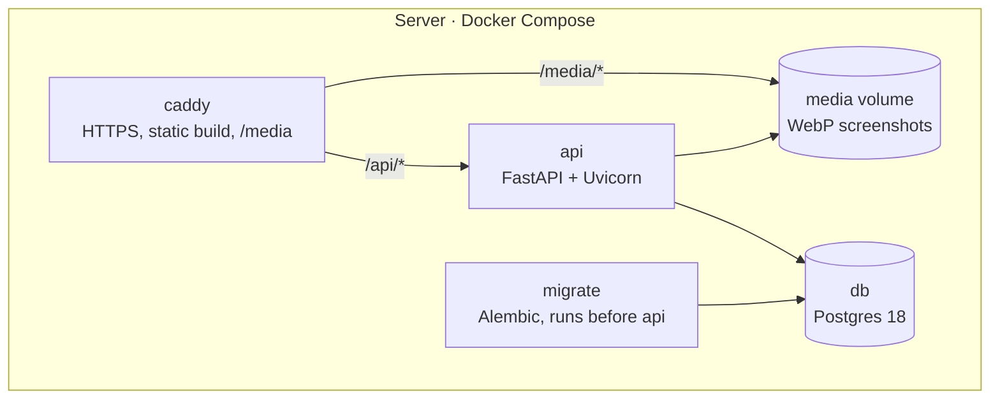
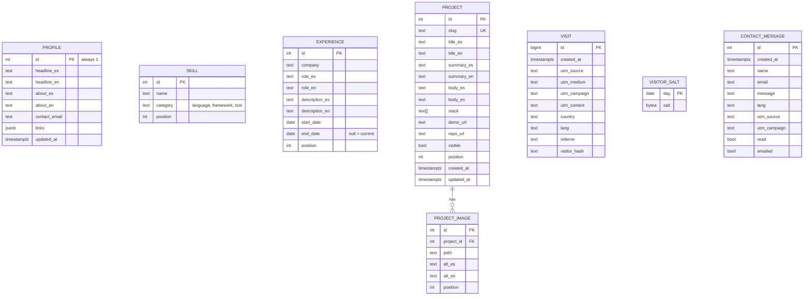
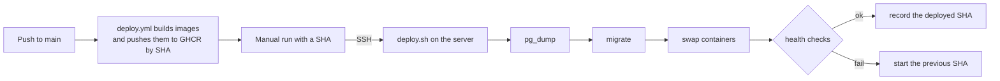

# Architecture

A static React app, a FastAPI API and Postgres, served under one domain by Caddy and run with Docker Compose. The reasoning behind each choice is in [docs/adr/](adr/).

## Components

| Component | Role |
|---|---|
| `web` | Public page and `/admin` panel, built into static files and copied into the Caddy image |
| `api` | Content, admin session, contact, visits and screenshot uploads |
| `migrate` | Applies Alembic migrations; the only service with the table owner's password |
| `db` | Postgres 18 on a Docker volume |
| `caddy` | Automatic HTTPS, security headers, the static build, `/media` and the `/api` proxy |

The browser only talks to Caddy, so the page and the API share an origin: no CORS, a strict CSP (`connect-src 'self'`) and a `SameSite=Strict` session cookie.

The public page has a single night theme; its colors are CSS variables in `web/src/styles.css` and its fonts are bundled with the build. The hero's 3D figure is plain three.js in a chunk that loads only on wide screens with WebGL and without reduced motion ([ADR 0011](adr/0011-night-theme-and-3d-hero.md)).

## Request flow

- **First load:** the page calls `GET /api/bootstrap`, forwarding any `utm_*` parameters. The API records the visit, decides the language and returns the profile, skills, experience and visible projects in one response.
- **Admin:** `POST /api/admin/login` checks the Argon2 hash and sets a signed JWT cookie (`httpOnly`, `Secure`, `SameSite=Strict`, 7 days). Every `/api/admin/*` route requires it.
- **Contact:** `POST /api/contact` stores the message and sends the email notice in a background task. A failed email doesn't lose the message; it still shows in the panel.

## Language

The API picks Spanish when the first `Accept-Language` entry is Spanish, and English otherwise. A choice made with the page's language switch is saved in `localStorage`, sent with the request and takes precedence. The decision lives in one function in `api/app/services/locale.py` that also receives a country, so location-based detection can be added later without touching anything else; `visit.country` already exists for it.

The page sets `<html lang>`, the title and the description to the language shown. There is one URL for both languages, so `hreflang` isn't used. `robots.txt` excludes `/admin`, and the panel also sends `noindex`.

## Data model

Bilingual content uses `_es` and `_en` columns ([ADR 0003](adr/0003-bilingual-content-in-columns.md)).

- **No users table.** The single administrator's email and password hash come from environment variables ([ADR 0004](adr/0004-single-admin.md)).
- **Visits store no IP.** `visitor_hash` is a hash of the IP and user agent with a salt that changes daily, enough to count unique visitors per day. Only the referrer's domain is kept.
- **Screenshots** are limited to 5 MB and 25 megapixels, resized to at most 2560 px and converted to WebP with Pillow.
- **Migrations only add.** Removing a column takes two releases: stop using it, then drop it. That keeps the previous release working against the new schema, so a rollback never needs a database restore.

## Security

- **Database users:** the API connects as a user that can only read and write rows; table ownership and migrations use a separate user that only `migrate` knows ([api.md](api.md#database-two-users)).
- **Login:** Argon2 hashes and at most 5 failed attempts per IP every 15 minutes.
- **Contact:** a honeypot field and at most 5 messages per IP per hour.
- **Client IP:** `X-Forwarded-For` is read only from Caddy's fixed internal network (`TRUSTED_PROXIES`).
- **Headers:** `web/security-headers.ts` and `deploy/Caddyfile` set the same CSP, `nosniff`, frame denial, referrer and permissions policies; production adds HSTS. The build ships no source maps.
- **Containers:** no root, no capabilities, read-only file systems and memory limits ([deploy/README.md](../deploy/README.md#decisions-in-this-folder)).
- **Logs:** no access logs and no personal data.
- **Secrets:** only in each server's `deploy/.env` and in GitHub environment secrets, never in the repository.

## Deployment

Images are built in CI, never on the server. A rollback is the same manual run with an older SHA. A daily `backup.sh` encrypts the database and `/media` with age and uploads them to a private bucket the server can write to but not read. Both scripts are described in [deploy/README.md](../deploy/README.md).

The site runs on an Oracle Cloud Always Free VM ([ADR 0010](adr/0010-free-tier-deployment.md)); the stack is plain Docker Compose, so it moves to a paid VPS ([ADR 0001](adr/0001-vps-deployment-docker-compose.md)) by changing the host and the secrets.
