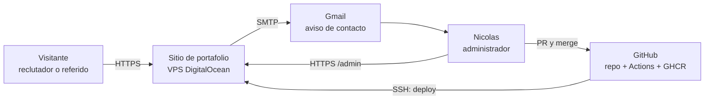
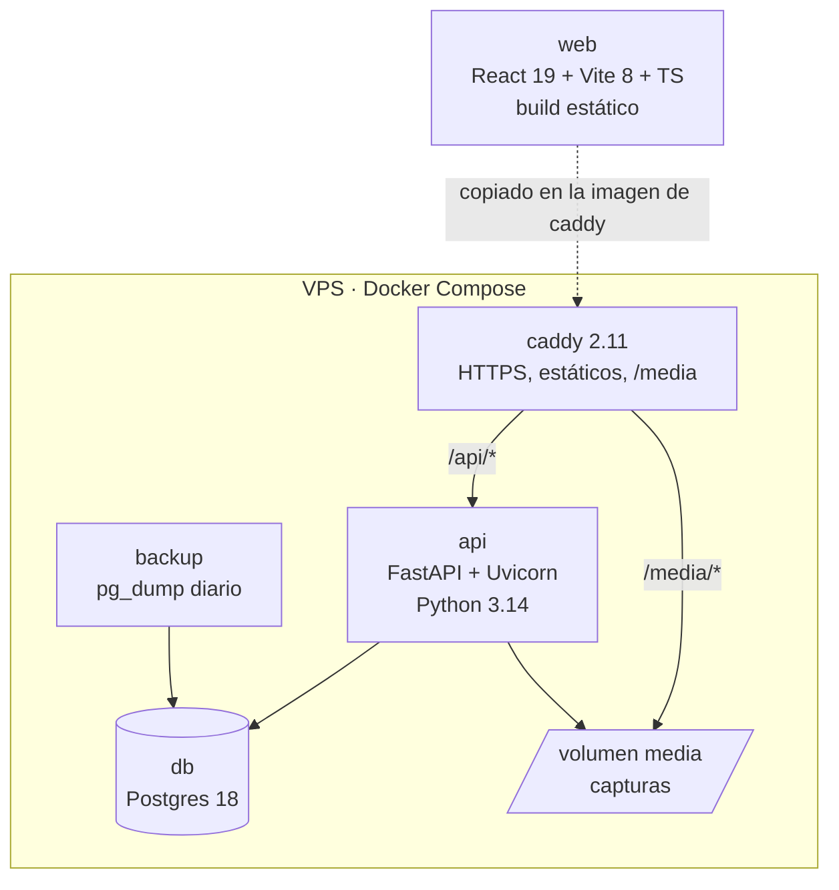
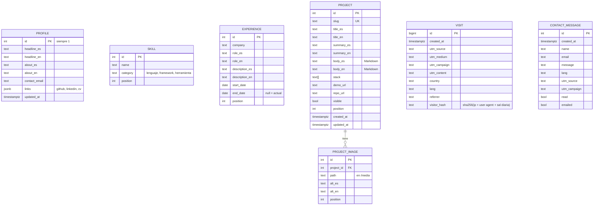

# Arquitectura · Sitio web de portafolio

ID: 2026-10-08-sitio-portafolio · Versión: borrador 2 (2026-10-11) · Brief: `brief.md`

Versiones revisadas el 2026-10-11 en PyPI, npm y Docker Hub. Precios tomados de las páginas oficiales ese mismo día, en USD (dólares estadounidenses) y a unos 950 CLP (pesos chilenos) por dólar.

## 1. Resumen

Es un monorepo con tres piezas: un frontend estático en React, una API (interfaz de programación que entrega los datos) en FastAPI y Postgres. Todo corre con Docker Compose en un VPS (servidor virtual privado), detrás de Caddy, que sirve el frontend, pasa `/api` a FastAPI y renueva solo el certificado HTTPS (conexión cifrada). El idioma se decide por el que tiene configurado el navegador del visitante; la detección por país queda preparada para más adelante. GitHub Actions prueba cada PR (pull request, propuesta de cambios), respalda la base antes de cada despliegue y, en cada merge a `main`, construye las imágenes y las despliega por SSH (acceso remoto cifrado al servidor).

El costo es de unos US$7,20 al mes (~$6.800 CLP) más el dominio .cl a $9.990 al año.

## 2. Despliegue (se decide primero)

**Decidido: A, VPS propio** (Nicolas, 2026-10-11).

| Opción | Costo mensual | Trabajo extra | Contras |
|---|---|---|---|
| **A. VPS propio** (DigitalOcean Basic, 1 vCPU (procesador virtual), 1 GiB (gibibyte) de memoria y 25 GiB de disco) | US$6 + US$1,20 de respaldo semanal = US$7,20 | ~6 h para configurar el servidor, SSH y respaldos | Tú mantienes el servidor (actualizaciones, disco) |
| B. Render (API US$7 + Postgres US$6, frontend estático gratis) | US$13 | ~1-2 h | Cada producto nuevo suma lo mismo; menos que mostrar en DevOps (operación y despliegue de software) |
| C. Casi gratis (Fly.io US$3,69 + Neon gratis + hosting estático) | ~US$2-4 | ~4 h y tres proveedores | La API y la base se duermen, y la primera visita tarda en despertar |

Sobre el contra de C: se puede evitar, pero deja de ser casi gratis. En Fly.io habría que dejar una máquina siempre encendida (`min_machines_running = 1`), y en el plan gratis de Neon la suspensión tras 5 minutos no se puede desactivar. Mantenerla despierta con pings tampoco sirve, porque un mes completo encendida gasta más que las 100 CU-hora (unidades de cómputo por hora) incluidas y la base se suspende hasta el mes siguiente. El VPS (opción A) no tiene este problema: todo está siempre encendido.

Descarté los planes gratis de Render: la API se duerme a los 15 minutos y tarda ~1 minuto en despertar, y la base gratis expira a los 30 días. Hetzner sale un poco más barato, pero hoy sus planes más baratos figuran como no disponibles.

**Por qué A:** es la opción más barata sin arranques lentos. Además, la misma máquina aloja los próximos productos sin costo extra, y "CI/CD (integración y despliegue continuos) a un servidor propio con Docker" es justo lo que piden las ofertas revisadas. Con 1 GiB alcanza porque las imágenes se construyen en GitHub Actions y no en el servidor. DigitalOcean no tiene región en Sudamérica; uso Nueva York, que agrega unos 150 ms (milisegundos) de latencia y es aceptable para una página así.

## 3. Contexto



## 4. Componentes



| Componente | Tecnología (versión) | Responsabilidad |
|---|---|---|
| web | React 19.3, Vite 8.3, TypeScript (TS) 7.0, React Router 8, TanStack Query 5, Vitest 5 | Página pública y panel `/admin`. Se compila a archivos estáticos. |
| api | FastAPI 0.143, Pydantic 2.14, SQLAlchemy 2.1, Alembic 1.20, Uvicorn 0.54, pytest 9 | Contenido, login del administrador, contacto, visitas y subida de capturas. |
| db | Postgres 18 | Datos. Un volumen de Docker. |
| caddy | Caddy 2.11 | HTTPS automático, sirve `web` y `/media`, y pasa `/api` a la API. |
| backup | Script con `pg_dump` y cron | Copia diaria de la base y de `/media`, guardando 7 días, y una copia extra antes de cada despliegue. Además, el respaldo semanal de DigitalOcean. Detalle en la sección 6. |

TypeScript 7.0 es la primera versión con el compilador nativo. Si alguna herramienta no lo soporta todavía, se usa 6.x sin cambiar nada más.

### Cómo se comunican

- El navegador solo habla con Caddy. Frontend y API comparten dominio, así que no hay CORS (restricción del navegador para pedir datos a otro dominio).
- **Primera carga:** el frontend llama a `GET /api/bootstrap?utm_source=…`. La API registra la visita con sus UTM (parámetros del enlace que indican de dónde viene la visita) y, si está disponible, su país; decide el idioma y devuelve el perfil, las habilidades, la experiencia y los proyectos visibles, todo en una sola respuesta.
- **Panel:** `POST /api/admin/login` deja una cookie `httpOnly`, `Secure` y `SameSite=Strict` firmada (JWT, JSON Web Token, un token firmado, de 7 días). Las rutas `/api/admin/*` la exigen.
- **Contacto:** `POST /api/contact` guarda el mensaje y envía el correo en una tarea de fondo de FastAPI. Si el correo falla, el mensaje igual queda guardado y se ve en el panel.

### Idioma según ubicación

| Opción | Costo | Contras |
|---|---|---|
| **A. País desde Cloudflare** (header `CF-IPCountry`, gratis en el plan Free) | ~1 h; el DNS del dominio pasa a Cloudflare | Depende de Cloudflare; en local se simula el header |
| B. País por IP (dirección de red del visitante) con la base GeoLite2 de MaxMind | ~3 h y actualizar la base cada mes | Más piezas para lo mismo |
| C. Idioma del navegador (`Accept-Language`) | 0 h | No es la ubicación, que es lo que pediste |

**Decidido: C para la versión 1, A más adelante** (Nicolas, 2026-10-11). El idioma sale del header `Accept-Language` del navegador: si el primero de la lista es español, la página sale en español, y si no, en inglés. La elección manual en el selector se guarda en `localStorage` y manda sobre lo anterior.

Para que pasar a A sea un cambio pequeño, la API decide el idioma en una sola función que recibe el país (vacío por ahora) y el `Accept-Language`, y la tabla de visitas ya tiene la columna `country`. Cuando el sitio crezca, basta con poner Cloudflare delante y leer `CF-IPCountry` en esa función.

### Aviso por correo

| Opción | Costo | Contras |
|---|---|---|
| **A. SMTP (protocolo de envío de correo) de Gmail con contraseña de aplicación** | Gratis, ~30 min | Requiere verificación en dos pasos; el correo te llega desde tu propia cuenta |
| B. Resend (3.000 correos al mes y 100 al día gratis) | Gratis, ~1 h | Hay que verificar el dominio con registros DNS |

**Decidido: A** (Nicolas, 2026-10-11). El único destinatario eres tú, así que basta. Si después hace falta enviar correos a terceros, se cambia a B sin tocar el resto, porque el envío queda detrás de una función.

## 5. Modelo de datos

El contenido bilingüe va en columnas `_es` y `_en`. Para dos idiomas fijos es más simple que una tabla de traducciones.



- **El administrador no es una tabla.** Su correo y el hash Argon2 de su contraseña vienen de variables de entorno. Con un solo usuario, una tabla de usuarios sobra.
- **Visitas:** no se guarda la IP, solo un hash con una sal que cambia cada día. Eso alcanza para contar visitantes únicos por día sin guardar datos personales. El panel agrupa por `utm_source` y `utm_campaign`.
- **Capturas:** se suben desde el panel, con un máximo de 5 MB (megabytes), y la API las convierte a WebP (formato de imagen liviano) con Pillow y las guarda en `/media`.
- **Migraciones:** Alembic. Las aplica el script de despliegue, después del respaldo y antes de cambiar los contenedores (sección 7). En local se aplican al arrancar.

## 6. Seguridad, en proporción a un MVP (producto mínimo viable)

- Login: Argon2, máximo 5 intentos fallidos cada 15 minutos por IP, y la cookie descrita arriba.
- Contacto: un campo trampa (honeypot) y un límite de 5 mensajes por hora por IP. Sin captcha mientras no llegue spam.
- VPS: acceso SSH solo con llave y con un usuario `deploy` que no es root; `ufw` con los puertos 22, 80 y 443 abiertos; `unattended-upgrades` para los parches de seguridad.
- Secretos: en `.env` en el VPS y en GitHub Secrets. Nunca en el repositorio.

### Respaldos: para qué sirve `pg_dump` y por qué

`pg_dump` es la herramienta oficial de Postgres para exportar una base completa a un archivo, mientras la base sigue funcionando y sin detenerla. Ese archivo se puede restaurar con `pg_restore` en cualquier Postgres, en el mismo servidor o en otro.

Se usa en dos momentos:

1. **Todos los días** (cron a las 04:00 de Chile): exporta la base comprimida y copia `/media`. Guarda los últimos 7 días en el VPS.
2. **Antes de cada despliegue:** el workflow lo corre antes de aplicar migraciones. Si una migración daña datos, se vuelve al estado justo anterior.

El criterio fue cubrir lo que el respaldo de DigitalOcean no cubre, al menor costo:

| Necesidad | Solo respaldo semanal de DigitalOcean (US$1,20) | + `pg_dump` diario (gratis) |
|---|---|---|
| Datos que se pueden perder | Hasta 7 días | Hasta 24 horas |
| Volver atrás una migración o un borrado por error | Restaurar el servidor completo | Restaurar solo la base, en minutos |
| Llevar los datos a otro proveedor | No: es una imagen del disco de DigitalOcean | Sí: es un archivo estándar de Postgres |
| Si se pierde el servidor completo | Cubre | No cubre (las copias están en el mismo disco) |

Por eso van los dos: el respaldo de DigitalOcean cubre la pérdida del servidor, y `pg_dump` cubre los errores del día a día. Sacar las copias del servidor a un almacenamiento externo (por ejemplo DigitalOcean Spaces, US$5 al mes) no se justifica todavía, porque los datos importantes (proyectos y perfil) también se pueden reconstruir desde el panel. Antes de publicar se prueba una restauración completa una vez.

## 7. Repositorio, CI/CD y despliegue

### Estructura

```
plantilla-producto/        repo plantilla (GitHub "template repository")
portfolio-page/            creado desde la plantilla, público
├── api/                   FastAPI, Alembic, pytest
├── web/                   React, Vite, Vitest
├── deploy/                compose.prod.yml, Caddyfile, backup.sh
├── compose.yml            desarrollo local (db + api + web con recarga en vivo)
└── .github/
    ├── dependabot.yml     actualizaciones semanales de dependencias
    └── workflows/
        ├── ci.yml         pruebas; se ejecuta en cada PR y la reutiliza deploy.yml
        └── deploy.yml     en cada merge a main, o a mano para volver a una versión anterior
```

La plantilla es este mismo esqueleto, con una API y una página vacías y los mismos workflows. El primer hito del plan la deja probada en CI con `deploy-check`, sin costo; los servidores se contratan en el último hito (decisión de Nicolas, 2026-10-11).

### Decisiones de CI/CD

| Tema | Decisión | Por qué |
|---|---|---|
| Ramas | `feature/*` → `dev` (integración, se despliega a staging) → `main` (producción). Todo merge es rebase & merge. Detalle en las ADR 0007 y 0008. | Probar en staging antes de publicar; `main` siempre es lo publicado y el historial queda lineal. |
| Reglas de `main` y `dev` | PR obligatorio, tests, seguridad y E2E (de punta a punta) en verde, más aprobación. Detalle en la ADR 0007. | Lo pediste en la revisión del 2026-10-11. |
| Qué prueba `ci.yml` | API: `ruff` (lint y formato) y `pytest` contra un Postgres 18 de servicio. Web: `tsc`, ESLint, Vitest y `vite build`. Además construye las imágenes Docker sin publicarlas. | Si la imagen no construye, el problema aparece en el PR y no al desplegar. |
| Velocidad | Los jobs de API y web corren en paralelo, con caché de pip, npm y capas de Docker. | Mantener el CI bajo ~5 minutos. |
| Cuándo despliega | `deploy.yml` corre en cada push a `main`, primero llama a `ci.yml` y solo despliega si pasa. También tiene un botón manual (`workflow_dispatch`) que recibe un SHA para volver a una versión anterior. | Nada llega a producción sin pruebas, y el rollback es el mismo camino. |
| Imágenes | Se publican en GHCR con dos etiquetas: el SHA y `latest`. El servidor siempre despliega por SHA. | Saber exactamente qué versión está corriendo y poder volver a cualquiera. |
| Un despliegue a la vez | `concurrency: production`, sin cancelar el que está en curso. | Dos merges seguidos no pisan un despliegue a medias. |
| Secretos | Ambiente `production` de GitHub con `SSH_HOST`, `SSH_USER` y `SSH_KEY`. Los secretos de la app (base, SMTP, administrador) viven solo en el `.env` del VPS. | Si se filtra el repo o el CI, no se filtran las claves de la app. |
| Permisos del workflow | `contents: read` y `packages: write`, nada más. Para publicar en GHCR basta el `GITHUB_TOKEN` del propio workflow. | Mínimo privilegio, sin tokens personales. |
| Migraciones | Respaldo con `pg_dump`, después `alembic upgrade head` y después el cambio de contenedores. Las migraciones solo agregan (columnas nuevas opcionales) y nunca borran en el mismo despliegue. | Postgres revierte una migración fallida completa, y como la migración no borra nada, el código anterior sigue funcionando con la base nueva si hay rollback. |
| Verificación y rollback | `GET /api/health` (que también consulta la base) debe responder 200 en menos de 60 s. Si no, el mismo job vuelve al SHA anterior y queda en rojo. | No dejar el sitio caído esperando a que lo revises. |
| Avisos | El correo de GitHub cuando falla un workflow. | Es gratis y ya existe. |
| Dependencias | Dependabot semanal para pip, npm, Docker y Actions, agrupado en un PR por ecosistema de paquetes (pip, npm, Docker, Actions). El CI decide si se mergea. | Parches de seguridad sin revisar a mano. |
| Ambientes | Local, staging (ambiente de prueba que replica producción) y producción. La opción de staging está en la ADR 0008. | Lo pediste en la revisión del 2026-10-11, para probar antes de producción. |

Las versiones de las Actions revisadas hoy son `actions/checkout@v7`, `actions/setup-python@v7`, `actions/setup-node@v7`, `docker/login-action@v4`, `docker/setup-buildx-action@v4` y `docker/build-push-action@v7`.

El repo del sitio es público porque es parte del portafolio. Así las imágenes en GHCR son gratis y GitHub revisa los secretos que se suban por error (secret scanning).

### Esqueleto de `deploy.yml`

Solo para mostrar la forma. El archivo real se escribe en el hito 1 del plan.

```yaml
name: deploy
on:
  push: { branches: [main] }
  workflow_dispatch:
    inputs:
      sha: { description: "SHA a desplegar (rollback)", required: true }
concurrency: { group: production, cancel-in-progress: false }
permissions: { contents: read, packages: write }

jobs:
  ci:
    if: github.event_name == 'push'
    uses: ./.github/workflows/ci.yml        # mismas pruebas que el PR

  build:
    needs: ci
    runs-on: ubuntu-latest
    steps:
      - uses: actions/checkout@v7
      - uses: docker/login-action@v4
        with:
          registry: ghcr.io
          username: ${{ github.actor }}
          password: ${{ secrets.GITHUB_TOKEN }}
      - uses: docker/setup-buildx-action@v4
      - uses: docker/build-push-action@v7   # se repite para api y caddy
        with:
          context: ./api
          push: true
          tags: ghcr.io/${{ github.repository }}/api:${{ github.sha }}

  deploy:
    needs: build
    if: ${{ !failure() && !cancelled() }}   # también corre en el despliegue manual
    runs-on: ubuntu-latest
    environment: production
    steps:
      - name: Desplegar por SSH
        run: |
          # carga la llave SSH_KEY y ejecuta en el VPS:
          #   deploy/deploy.sh <sha>
          #   1. pg_dump de respaldo
          #   2. docker compose pull  (IMAGE_TAG=<sha>)
          #   3. alembic upgrade head
          #   4. docker compose up -d
          #   5. curl /api/health, y si falla, vuelve al SHA anterior y sale con error
```

## 8. Decisiones que irán como ADR (registro de decisión de arquitectura)

1. 0001 Despliegue en VPS con Docker Compose y Caddy (decidido).
2. 0002 Idioma según el navegador en la versión 1, con la detección por país (Cloudflare) preparada para después.
3. 0003 Contenido bilingüe en columnas `_es` y `_en`.
4. 0004 Administrador único con credenciales en variables de entorno.
5. 0005 Aviso de contacto por SMTP de Gmail.
6. 0006 CI/CD con GitHub Actions: pruebas reutilizadas, imágenes por SHA, respaldo antes de migrar y rollback automático.

## 9. Riesgos

| Riesgo | Mitigación |
|---|---|
| El VPS se queda sin disco o memoria | Rotación de logs de Docker, respaldos guardados solo 7 días y alerta de uso de DigitalOcean (gratis) |
| Perder datos | `pg_dump` diario y antes de cada despliegue, más el respaldo semanal de DigitalOcean (sección 6). Probar una restauración una vez antes de publicar. |
| Una migración rompe producción | Respaldo previo, migraciones que solo agregan y rollback automático si falla el health check |
| El despliegue es tu punto débil | Va primero en el plan, con una página vacía |
| TypeScript 7 o Vite 8 no se llevan con alguna librería | Bajar a TypeScript 6 o Vite 7 sin cambiar la arquitectura |
